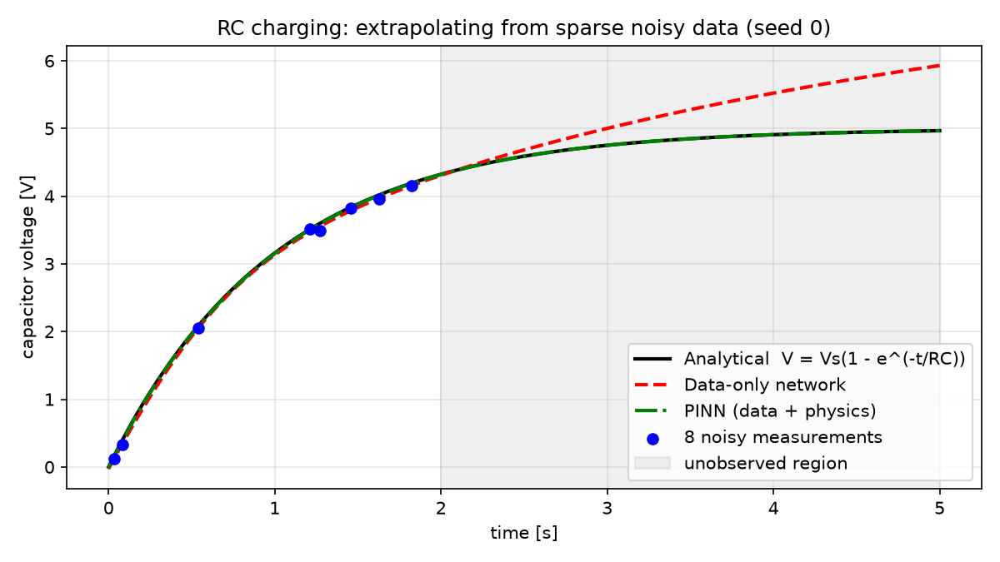
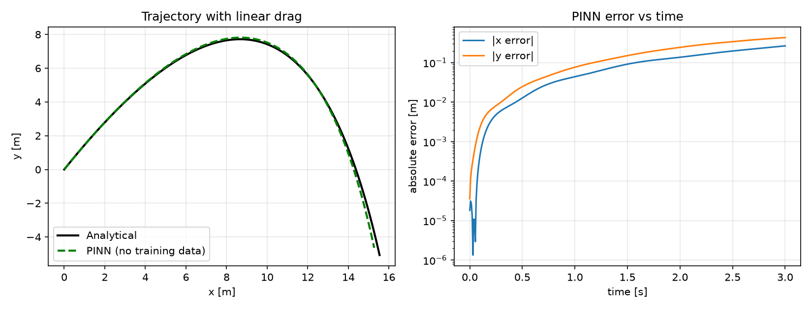

# Physics-Informed Neural Networks for Circuit & Motion Dynamics

[](../../actions)

A small, fully reproducible study of **Physics-Informed Neural Networks (PINNs)** in PyTorch, applied to two
problems with known closed-form solutions so every result can be verified exactly:

1. **RC charging circuit** - PINN vs. a purely data-driven network when only 8 noisy measurements from the
   first 40 % of the transient are available. Which one extrapolates correctly?
2. **Projectile with linear air drag** - a PINN that learns the 2-D trajectory from the differential equations
   and initial conditions alone, with **zero training data**.

## Key results (all produced by `python run_experiments.py`, CPU only, ~90 s)

### 1. RC circuit: extrapolation from sparse, noisy data
Same network size, same 8 data points (noise sigma = 0.05 V), 5 random seeds, 4000 Adam epochs.
Error is relative L2 against the analytical solution `V(t) = Vs(1 - exp(-t/RC))`.

| Model | Error inside observed window | Error in **unobserved** window | Max abs. error |
|---|---|---|---|
| Data-only network | 1.22 % +/- 0.16 | **10.64 % +/- 3.77** | 0.886 V |
| **PINN (data + ODE residual)** | 0.20 % +/- 0.13 | **0.12 % +/- 0.16** | 0.011 V |

(mean +/- std over 5 seeds.) Both fit the observed points; only the PINN knows the circuit physics, so only
it extrapolates correctly.



### 2. Projectile with drag: solving the ODE with no data
Network `t -> (x, y)` trained only on ODE residuals + initial position/velocity (6000 epochs).

| Metric | x | y |
|---|---|---|
| Relative L2 error | 1.17 % | 4.11 % |
| Max absolute error | 0.26 m | 0.42 m |



Full numbers (including per-seed values) are in [`results/results.json`](results/results.json).

## Method

Network: MLP with `tanh` activations (smooth, so second derivatives exist). Derivatives come from PyTorch autograd.

* RC: `L = L_data + L_physics + L_IC`, with `L_physics = mean( (dV/dt - (Vs - V)/RC)^2 )` on 200 collocation points
  spanning the *whole* time window, including where no data exist.
* Projectile: `L = L_physics + 10 * L_IC`, residuals `x'' + k x'` and `y'' + g + k y'`.
* Time and voltage are normalised so the loss terms have similar magnitude.

## Limitations (read before over-trusting these numbers)

* Both problems are simple ODEs chosen *because* they have exact solutions. This is a methodology demo, not a
  claim that PINNs beat classical solvers: for these ODEs, RK4 is faster and more accurate.
* In the projectile case the error **grows with time** (see right plot). This is a known PINN behaviour
  (errors in early times propagate; causal-training schemes address it). I did not implement those.
* Results are from a single hyper-parameter setting; no extensive tuning was done.
* Only 5 seeds, so the standard deviations are rough.

## Reproduce

```bash
git clone <this repo> && cd pinn-circuit-dynamics
python -m venv .venv && source .venv/bin/activate
pip install -r requirements.txt
pytest -q                    # 7 tests: analytical solutions, autograd, PINN > data-only
python run_experiments.py    # regenerates results/ (figures + results.json)
```

## Project layout

```
src/pinn/physics.py      analytical solutions + parameters
src/pinn/models.py       MLP + autograd derivative helper
src/pinn/rc_circuit.py   RC experiment (PINN vs data-only)
src/pinn/projectile.py   projectile PINN (no data)
tests/                   unit + integration tests
run_experiments.py       reproduces all results and plots
```

## Possible extensions
Second-order RLC circuit, unknown-parameter (inverse) problems such as estimating `R*C` from data,
causal training weights, comparison against RK4 in runtime and accuracy.

## License
MIT
